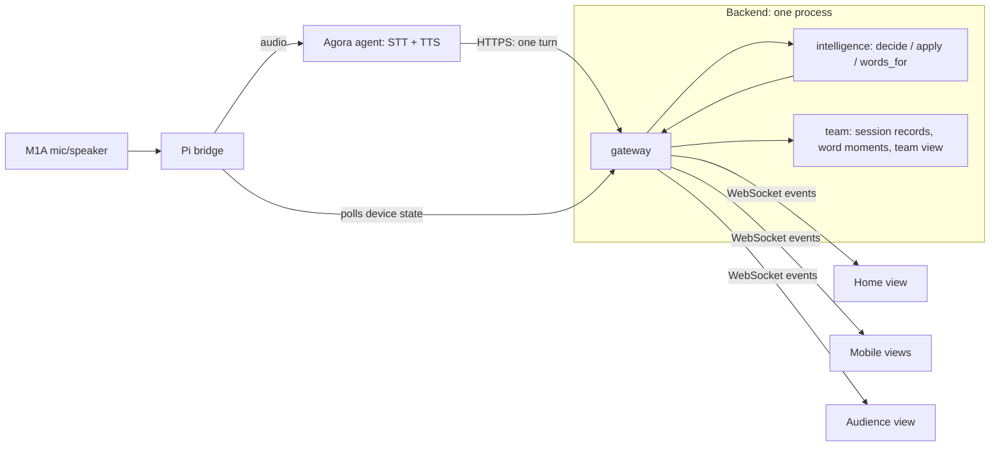

# Mochi

Mochi is language learning for companies, in their own meetings (English and Brazilian
Portuguese). A small device on the meeting table, or a phone with the app, listens during
a meeting people start, tells registered voices apart, shows a one-word hint when someone is stuck,
and remembers the words each person needed. Later each person goes over their words with Mochi in a
**review** on their phone, and the company's administrators see how the team is doing in a **team
view**. Product and contracts: [`AGENTS.md`](AGENTS.md); the company data model and its API:
[`docs/TEAM_VIEW.md`](docs/TEAM_VIEW.md). This repository holds the **backend**,
the shared contracts and the scripts, the web app (`apps/web`: Onboarding, Session, Training, Digest and Analytics, deployed as `mochi-web`),
the Mochi AR glasses app (`apps/glasses`, outside the hackathon MVP) and the Pi bridge
(`hardware/`); each app has its own README and owner.



## Quick start (fake Agora, 3 commands)

```bash
make -C services/backend install          # uv sync (needs uv: https://docs.astral.sh/uv/)
scripts/start-dev.sh                      # backend on :8000, MOCHI_AGORA_MODE=fake, dev routes on
scripts/smoke.sh                          # in another terminal: PASS/FAIL per demo step
```

Try it by hand: `curl -X POST localhost:8000/api/sessions/demo/start`, then
`scripts/say.sh "I need to adiar my meeting tomorrow"`, and watch events with
`uv run --project services/backend python scripts/watch_ws.py --as user=ana`. A review:
`curl -X POST localhost:8000/api/sessions/p-1/start -H 'content-type: application/json' -d '{"mode":"review","user_id":"ana"}'`.
The team view: `curl 'localhost:8000/api/companies/demo/insights?viewer=ana'`.

## Dependencies and versions

Python 3.12, [uv](https://docs.astral.sh/uv/) 0.13.9 (locked in `services/backend/uv.lock`), FastAPI,
uvicorn, httpx, pydantic v2 + pydantic-settings, `agora-token-builder` 1.0.0. Dev: ruff, mypy (strict),
pytest, pytest-asyncio. Docker (optional) for the image. `jq` for `scripts/smoke.sh`.

**Version identification:** `GET /healthz` returns `{"status":"ok","version":"<git sha>"}`. The SHA is
the `GIT_SHA` build argument (`scripts/deploy.sh` passes `git rev-parse --short HEAD`); it reads `dev`
when run from source.

## Real Agora setup

1. In the Agora Console create a project with an App Certificate; create RESTful API keys.
2. Copy `.env.example` to `.env`; set `AGORA_APP_ID`, `AGORA_APP_CERTIFICATE`, `AGORA_REST_KEY`,
   `AGORA_REST_SECRET`, `MOCHI_TURN_KEY` (any long random string), and `MOCHI_AGORA_MODE=real`.
3. Speech vendors: `.env.example` holds a working setup. With `MODEL_API_KEY` the ears are OpenAI transcription (first choice) with ARES as the automatic fallback; without it ARES alone. The voice is Agora-managed minimax. Otherwise set `MOCHI_ASR_VENDOR`, `MOCHI_ASR_PARAMS`, `MOCHI_TTS_VENDOR`,
   `MOCHI_TTS_PARAMS` (JSON objects; see `services/backend/src/mochi_backend/gateway/agora/VERIFIED.md`).
4. Give the backend a public HTTPS address: `scripts/tunnel.sh` (cloudflared or ngrok) or Render, and set
   `MOCHI_PUBLIC_URL` to it.
5. Optional: `MODEL_API_KEY` (+ `MOCHI_MODEL_BASE_URL`, `MOCHI_MODEL_NAME`) for words outside the built-in
   lexicon. Without it the rule-based cases (including both demo sentences) still work.

## Environment variables

| Variable | Default | Meaning |
|---|---|---|
| `AGORA_APP_ID`, `AGORA_APP_CERTIFICATE` | - | Agora project (required when `MOCHI_AGORA_MODE=real`) |
| `AGORA_REST_KEY`, `AGORA_REST_SECRET` | - | Agora RESTful API credentials (required in real mode) |
| `MOCHI_TURN_KEY` | - | Shared key Agora sends to the turn endpoint (required; `dev-turn-key` in fake mode) |
| `MOCHI_PUBLIC_URL` | `http://localhost:8000` | Public HTTPS address Agora calls |
| `MOCHI_AGORA_MODE` | `real` | `fake` runs without Agora |
| `MOCHI_SILENCE_STRATEGY` | `empty_reply` | or `mute_speaker` (fallback, AGENTS 12.1) |
| `MOCHI_ENABLE_DEV_ROUTES` | `false` | enables `POST /dev/sessions/demo/turn` |
| `MODEL_API_KEY` | - | language-model key (optional) |
| `MOCHI_MODEL_BASE_URL`, `MOCHI_MODEL_NAME` | OpenAI, `gpt-4o-mini` | OpenAI-compatible model |
| `MOCHI_MODEL_REASONING_EFFORT` | empty | `none` for a gpt-5 family hint model (D-29) |
| `MOCHI_HINT_COOLDOWN` | `two_turns` | `while_shown`: a new hint waits only until the last one left the screen (D-29) |
| `MOCHI_CHANNEL`, `MOCHI_PI_UID`, `MOCHI_AGENT_UID`, `MOCHI_TOKEN_TTL_SECONDS` | `mochi-demo`, 1001, 1002, 3600 | RTC channel, uids, token life |
| `MOCHI_CHARACTER_ENABLED`, `MOCHI_CHARACTER_MODEL_NAME`, `MOCHI_CHARACTER_TIMEOUT_SECONDS`, `MOCHI_FOLLOW_UP_SECONDS`, `MOCHI_GREETING_EN`, `MOCHI_GREETING_PT` | true, gpt-5.4-mini, 6, 20, greetings | Mochi's own voice when it is spoken to; needs `MODEL_API_KEY` (DECISIONS D-23) |
| `MOCHI_ASR_VENDOR`, `MOCHI_ASR_LANGUAGE`, `MOCHI_ASR_OPENAI_MODEL`, `MOCHI_ASR_PROMPT`, `MOCHI_ARES_LANGUAGE`, `MOCHI_ASR_KEYWORDS`, `MOCHI_ASR_CREDENTIAL_MODE`, `MOCHI_ASR_PARAMS` | openai, `en-US`, gpt-4o-transcribe, a prompt about mixing, `en-US,pt-PT`, `["Mochi"]`, empty, `{}` | speech-to-text: OpenAI transcription with `MODEL_API_KEY` (the key goes to Agora), else or on refusal ARES with the lexicon as keywords (DECISIONS D-25) |
| `MOCHI_TTS_VENDOR`, `MOCHI_TTS_CREDENTIAL_MODE`, `MOCHI_TTS_PARAMS` | minimax, empty, `{}` | text-to-speech (`.env.example` uses Agora-managed minimax) |
| `MOCHI_END_OF_SPEECH_SILENCE_MS` | 600 | pause that ends a turn (VAD) |
| `MOCHI_AGENT_IDLE_TIMEOUT_SECONDS` | 60 | Agora `idle_timeout`: the agent exits this long after the Pi leaves (0 = never; hard cap 72 h) |
| `MOCHI_HINT_TTL_SECONDS`, `MOCHI_DECIDE_TIMEOUT_SECONDS` | 8, 2 | hint lifetime; `decide()` time limit |
| `MOCHI_SPEAK_BASE_SECONDS`, `MOCHI_SPEAK_SECONDS_PER_WORD` | 0.6, 0.45 | speaking window for `mute_speaker` |
| `MOCHI_TEAM_MIN_PEOPLE` | 1 | the team view leaves out an expression fewer people than this needed (D-45); use 2 or 3 for a real company |
| `MOCHI_LIVE_TRANSCRIPT` | true | every finished sentence goes to the screens of its session (`transcript.line`) and to the device as a caption (D-51). There is no sign-in: set false where the meeting must not be readable by anyone who opens the page |
| `MOCHI_EXPLAIN_TERMS` | true | idioms and technical terms are explained to the people listening (D-53); one more small model call per sentence; needs `MODEL_API_KEY` |
| `MOCHI_SUGGEST_PHRASES` | true | after a hint, the whole sentence the speaker was reaching for is suggested, and one touch has Mochi say it (D-59); one small model call per hint; needs `MODEL_API_KEY` |
| `MOCHI_SUGGESTION_TTL_SECONDS` | 20 | how long the touch works after a suggestion |
| `MOCHI_SPEAK_FOR_ME` | true | "Mochi, speak for me" / "Mochi, translate for us": Mochi says every sentence of the meeting aloud in the other language (English ↔ Portuguese), whoever said it, until "Mochi, stop" / "Mochi, pode parar" (D-64, D-69). One model call per sentence |
| `MOCHI_SPEECH_REPORTS` | true | after Stop each person gets a private report of what was wrong in what they said (D-54); one model call per person and session; needs `MODEL_API_KEY` |
| `MOCHI_REPORT_MODEL_NAME` | (empty) | the model that writes the reports; empty: `MOCHI_MODEL_NAME` |
| `MOCHI_REPORT_REASONING_EFFORT` | (empty) | empty: `low` where `MOCHI_MODEL_REASONING_EFFORT` is set, else none |
| `MOCHI_REPORT_TIMEOUT_SECONDS` | 60 | how long one report may take to write |
| `MOCHI_CORS_ORIGINS`, `MOCHI_LOG_LEVEL`, `PORT` | `*`, `INFO`, 8000 | server |

## Docker

```bash
docker build -f services/backend/Dockerfile --build-arg GIT_SHA=$(git rev-parse --short HEAD) -t mochi-backend .
docker run --rm -p 8000:8000 -e MOCHI_AGORA_MODE=fake -e MOCHI_ENABLE_DEV_ROUTES=true mochi-backend
```

`scripts/deploy.sh` does the build, runs the container with `.env`, and checks `/readyz`. The build context
is the repo root. The image runs **one worker** (the session is in memory; saved words, users, voices and the company's history are in Postgres when `DATABASE_URL` is set).

## Render

`render.yaml` is a Blueprint: Render dashboard > New > Blueprint > pick this repo, fill the secrets
(`sync: false`), then set `MOCHI_PUBLIC_URL` to the service URL. It uses the `free` plan (the budget is $0): the
service spins down after 15 minutes of silence and takes about a minute to wake, so an uptime check must ping
`/healthz` before a demo. `numInstances: 1`. WebSockets work behind Render's proxy with a single instance.

## Demo-day checklist

1. `.env` filled; backend reachable (Render URL, or `scripts/tunnel.sh` and the printed URL in `MOCHI_PUBLIC_URL`).
2. `MOCHI_ENABLE_DEV_ROUTES=true` for the run (smoke needs it); then `scripts/smoke.sh` against that URL.
3. Open `/readyz`: `ready: true`, `agora_mode: real`, `public_url_set: true`. In real mode the backend refuses to
   start unless `MOCHI_PUBLIC_URL` starts with `https://`.
4. Pi bridge up (`GET /api/devices/home_pi_01/state` polled); Home view on Mochi, Mobile views on both phones,
   Audience view on the projector.
5. `scripts/reset-demo.sh`, then Start on the phone.

Real turn and Portuguese: `docs/REAL_TURN_RUNBOOK.md` (browser test client: `scripts/test-client.sh`).
6. Leave two ordinary turns between the two demo sentences: a hint silences the next two turns (AGENTS 7.2).

## Known unknowns (AGENTS section 12)

| # | Unknown | Status | Manual test on real hardware |
|---|---|---|---|
| 1 | Empty reply keeps the agent silent | **Unverified.** Not in Agora's docs. Fallback built: `MOCHI_SILENCE_STRATEGY=mute_speaker` | Start; say an ordinary sentence; Mochi must make no sound. If it does, switch the strategy |
| 2 | `adiar` / `guarda-chuva` survive speech-to-text | **Unverified.** `asr.language` is one tag; no documented code-switching | Say both demo sentences; read the `turn` log lines for the transcribed text |
| 3 | Audio both ways on the Pi without hearing itself | **Unverified** (Matheus) | Say `Oi Mochi, what's the word for fila?`; Mochi answers; confirm the answer is not logged as a new `turn` |
| 4 | Each sentence is stored with the person who said it | **Measured offline only** (D-46: 95 in 100 right, none wrong, on recorded voices) | Two registered voices take turns; read `GET /dev/sessions/demo/transcript` |

Verified against real Agora on 2026-11-20: it accepts the `006` tokens this builder produces, with the token
built for the agent uid (`join` returned an agent). Whether the Pi's IoT SDK accepts a `006` token is still open.
Details in `VERIFIED.md`.

## Layout, rules, tests

See [`docs/ARCHITECTURE.md`](docs/ARCHITECTURE.md), [`docs/DECISIONS.md`](docs/DECISIONS.md),
[`docs/PROVENANCE.md`](docs/PROVENANCE.md) and [`services/backend/AGENTS.md`](services/backend/AGENTS.md).
`make verify` runs format check, lint, mypy strict, architecture rules, pytest and the schema check.
