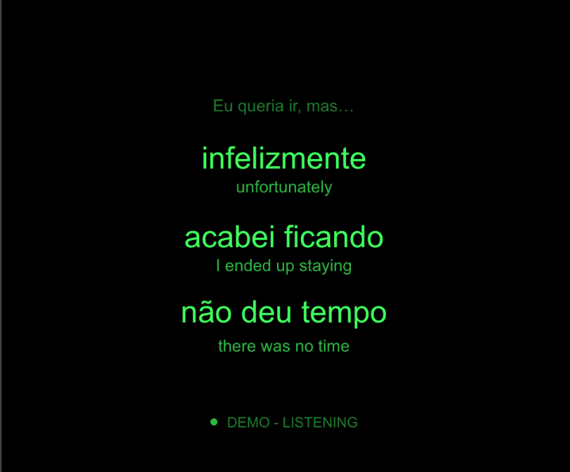

# Mochi AR — Fluency Helper for Rokid Glasses

Mochi AR is the smart-glasses add-on from the Mochi product vision (section 10.3, "Mochi AR"). It has one job, the **Fluency Helper**: when the wearer hesitates while speaking, one to three suggested words or phrases appear privately in their view, each with a short meaning.



It is an AIUI agent (Rokid's JavaScript app format for display glasses), written for the green monochrome Rokid Glasses (480 × 352).

## How it fits into Mochi

Mochi Home hears the conversation and the backend decides. The glasses only show what arrives for their wearer:

- They decide nothing: not what to suggest, not when, not to whom.
- They do not listen. Their microphone and camera are unused.
- They connect to the existing WebSocket as one more screen for one person.

### With the backend as it is today

The glasses connect to `GET /ws?user=<id>&surface=ar`. The backend (root `AGENTS.md` 6.6, proposed) gives this connection only `session.state.changed` and the `hint.created` / `hint.cleared` events aimed at the wearer or at nobody; it never receives learning events, the private prompt or other people's hints. An unknown `surface` or user is closed with code 4400 and the reason, and the app shows `REJECTED`. A hint without `candidates` shows its `expression` (up to three options separated by ` · `) and `meaning`.

### What this asks of the team contract (draft v0.4)

The vision asks for more than the contract's Hint (root `AGENTS.md`, section 6) carries today. The glasses work with v0.4 as it is, and read three **proposed, optional** additions. None has been agreed with the team yet, and nothing in `packages/contracts` was changed.

| Proposal | Where | Why |
|---|---|---|
| `candidates`: up to three `{ "expression", "meaning" }` | Hint payload of `hint.created` | "One to three short candidate words or phrases" |
| `context`: the words just before the speaker stopped | Hint payload of `hint.created` | The line above the suggestions |
| `&surface=ar` | `GET /ws?user=<id>&surface=ar` | Lets the gateway send predictive suggestions to glasses only (AR-exclusive) |

A hint without `candidates` shows its single `expression` and `meaning`. A gateway that ignores `surface` (an older backend) treats the glasses as that person's Mobile view.

```json
{ "hint_id": "hint_101", "target_user_id": "ana", "target_language": "en",
  "expression": "although", "meaning": "embora", "example": null,
  "reason": "trails_off", "expires_at": "2026-11-20T16:00:12.700Z",
  "context": "I wanted to go, but",
  "candidates": [
    { "expression": "although", "meaning": "embora" },
    { "expression": "unfortunately", "meaning": "infelizmente" },
    { "expression": "instead", "meaning": "em vez disso" } ] }
```

## What you see

| State | Screen |
|---|---|
| Session running, nothing to suggest | Empty, with `● LISTENING` at the bottom |
| Session stopped | Empty, with `○ NOT LISTENING` |
| Suggestions | A dim line of where the speaker stopped, then one to three bright phrases, each with its meaning under it; gone at `expires_at` |
| Backend unreachable | `○ RECONNECTING`; it keeps trying by itself |
| No backend configured | Demo mode: `DEMO - LISTENING`, replaying three examples |

Design choices, following the vision's "sparse, quickly readable, nonintrusive":

- The phrases are the only things at full brightness, so the eye lands on them. Context and meanings are dimmer.
- No numbers, frame or title. The wearer cannot select a suggestion, so numbering would be clutter.
- A fourth suggestion or beyond is dropped, and a long context keeps only its end.
- Enter (a tap on the temple) puts the suggestions away early. Back closes the agent.
- The MVP's two languages: status labels follow the glasses' language (English or Brazilian Portuguese), and the demo shows both directions, English with Portuguese meanings and Portuguese with English meanings.

## Run it

Needs Node.js 20 or later.

```bash
npm install
npm test            # event handling and connection tests, no glasses needed
npm run check       # Rokid's static check
npm run preview     # opens Rokid's preview runtime; prints a local URL
```

With no backend set, the preview runs in demo mode.

### Against a backend

Set `backendUrl` in `config.js` to the backend's public address (`MOCHI_PUBLIC_URL`) and `userId` to the wearer (`ana` or `ben`).

With the real backend on this machine (from the repository root):

```bash
scripts/start-dev.sh     # http://localhost:8000, fake Agora
# in apps/glasses/config.js: backendUrl: 'http://localhost:8000'
npm run preview --prefix apps/glasses

curl -X POST localhost:8000/api/sessions/demo/start
scripts/say.sh "I need to adiar my meeting tomorrow"
```

The backend does not send several suggestions yet. To see the three proposals at work, `tools/mock-backend.mjs` stands in for a gateway that has them. It is not the backend: it knows two words and one hesitation.

```bash
npm run mock-backend     # http://localhost:8787
# in config.js: backendUrl: 'http://localhost:8787'
npm run preview

curl -X POST localhost:8787/api/sessions/demo/start
curl -X POST localhost:8787/dev/sessions/demo/turn \
  -H 'content-type: application/json' \
  -d '{"text":"I wanted to go, but..."}'
```

### On the glasses

**Without a cable (Rokid's own route).** Run `npm run pack`, open [AIUI Studio](https://aiui-global.rokid.com/), sign in with your Rokid account, and create an agent with **New Agent → .aix Import**, choosing the packed file. In the **Device Debug** tab, run **Package and Save**. Then in the Hi Rokid app (iPhone or Android): **Settings → Developer → Update glasses resource package**, and open the agent by voice ("Hi Rokid, open Mochi AR").

**With the dev cable.**

```bash
npx aix device           # should list the glasses
npm run glasses          # installs the agent and opens the Fluency Helper
```

The glasses must be able to reach the backend address. `localhost` only works in the preview.

## Layout

```text
config.js                backend address and wearer
pages/fluency/index.ink  the Fluency Helper: screen, styles, and wiring
lib/protocol.js          event handling as pure functions
lib/connection.js        WebSocket that reconnects by itself
lib/mock-source.js       demo mode
lib/strings.js           status labels in English and Brazilian Portuguese
tools/mock-backend.mjs   stand-in gateway that has the three proposals
test/                    node --test
```

## Seen on real glasses

On 21 November the app ran on Rokid Glasses in demo mode, installed without a cable (AIUI Studio, then Hi Rokid on an iPhone, then "Hi Rokid, open Mochi AR"). The wearer reported the phrases readable at a glance, the dim context line legible, and a single temple tap dismissing the suggestions.

## Not verified yet

- **A real suggestion on the glasses.** Only demo mode has run on the hardware. The app's connection code was run against the real backend on a Mac (see above), with a typed sentence, not a spoken one.
- **The glasses reaching a backend.** No packaged build has had a `backendUrl` yet, so the glasses have not opened the WebSocket over Wi-Fi.
- **Several suggestions on a hesitation.** The backend sends one word per hint. Predicting one to three continuations is not built.
- **The three contract proposals above** need the team's agreement.
- **Delay.** A suggestion only helps if it arrives within a second or two of the hesitation; nothing here measures that.
- **How to leave the app.** Nothing on screen says how; the right gesture has not been confirmed.
