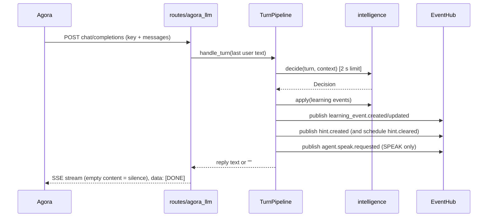

# Architecture

One process, two halves (AGENTS 4): the **gateway** talks to Agora, the Pi and the screens; **intelligence**
decides. Neither imports the other's internals.

## Module map

```
services/backend/src/mochi_backend/
  app.py            create_app(container); app_from_env (uvicorn --factory)
  composition.py    the only place adapters are built (default_adapters, build_container)
  settings.py       every env var, validated at startup
  platform/         clock, ids, scheduler, http_client, json_logging  (thin wrappers we own)
  gateway/
    intelligence_port.py   the ONLY door to intelligence (decide, handle, apply, words_for, reset)
    turn_pipeline.py       one chain for Agora turns and /dev turns
    event_hub.py           the only publisher: envelope, global sequence, per-connection routing, leak guard
    delivery_rules.py      pure routing table (AGENTS 6.2)
    live_hint.py           the hint on screen: expiry and replacement
    session_service.py     start/stop (and the Agora agent)
    device_service.py      device state for the Pi (token cached until near expiry)
    activity_service.py    Describe & Guess endpoints
    silence_policy.py      empty_reply | mute_speaker
    openai_sse.py          Agora-compatible streamed replies
    agora/                 client_port.py (ports), rest_client.py (the only Agora caller),
                           token_issuer.py, local_mock.py (fake mode), VERIFIED.md
    routes/                HTTP and WebSocket edges
  intelligence/     lexicon, language_guess, wake_phrase, quiet_rules, clear_cases (1-3),
                    subtle_cases (5-9), decision_flow, learning_rules, memory_store, round_engine,
                    model_port + openai_hint_model, service.Intelligence
packages/contracts/   Pydantic models (+ JSON examples and exported JSON Schema)
packages/fixtures/    decisions.json: 72 sentences with expected decisions
```

Ports (Protocols) wrap every third-party dependency: `AgoraAgentClient`, `RtcTokenIssuer`, `HintModel`,
`HttpClient`, `Clock`, `IdGenerator`, `Scheduler`, `EventLogger`, `IntelligencePort`. Tests replace them with
named fakes in `tests/fakes/`.

## One turn



## Routing table (enforced in `delivery_rules.py`, never in the browser)

| Event | Delivered to |
|---|---|
| `session.state.changed`, `activity.state.changed`, `agent.speak.requested` | every connection |
| `hint.created` / `hint.cleared` | Home, Audience, and the target user's Mobile (no target: every Mobile) |
| `activity.private_prompt` | the Home device only |
| `learning_event.created` / `.updated` | that user's Mobile only (no user: nobody) |

Extra guards in the hub: an `ACTIVE_ROUND` activity never carries `revealed_word`, and the Audience connection
never receives any message containing a protected secret word until the round result.

## Why exactly one worker

Session state, saved words, the game and the live hint are in this process's memory (AGENTS 8: no database).
A second worker or instance would have its own empty copy, so a phone could connect to a process that never
saw the turns. Run `--workers 1` and `numInstances: 1`. Timers (hint expiry) and the single global event
`sequence` also assume one process.

## How each owner takes over their directory

- **Kauê (`intelligence/`)**: replace or extend modules freely, as long as `Intelligence` keeps the five methods
  of `IntelligencePort`. Fixtures in `packages/fixtures/decisions.json` and `tests/fixture_support.py` run
  everything on a laptop. No import from `gateway` (enforced).
- **Luís (`gateway/`, `app.py`, `scripts/`)**: Agora specifics live only in `gateway/agora/`; update `VERIFIED.md`
  when an unknown is settled.
- **Matheus (`packages/contracts`, `hardware/`)**: the Python models here are the starting point; keep them
  equal to AGENTS 6. Proposals needing his approval are in `DECISIONS.md` (D-03, D-12).
- **Tasnim (`apps/web`)**: generate TypeScript types from `packages/contracts/schema/*.json`
  (`make -C services/backend contracts-schema`). Device-state JSON is documented in AGENTS 6.4.
