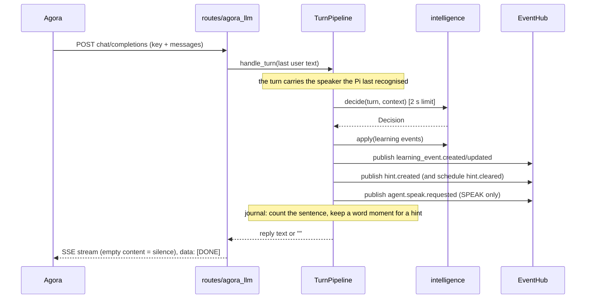

# Architecture

One process, two halves (AGENTS 4): the **gateway** talks to Agora, the Pi and the screens; **intelligence**
decides. Neither imports the other's internals. A third package, **team**, keeps the company's learning
history and computes the team view from it (D-45); it imports neither half.

## Module map

```
services/backend/src/mochi_backend/
  app.py            create_app(container); app_from_env (uvicorn --factory)
  composition.py    the only place adapters are built (default_adapters, build_container)
  settings.py       every env var, validated at startup
  platform/         clock, ids, scheduler, http_client, json_logging  (thin wrappers we own)
  gateway/
    intelligence_port.py   the ONLY door to intelligence (decide, apply, words_for, reset,
                           session_started, device_status)
    roster.py              the people known; the demo company and its two members
    turn_pipeline.py       one chain for Agora turns and /dev turns
    event_hub.py           the only publisher: envelope, global sequence, per-connection routing, leak guard
    delivery_rules.py      pure routing table (AGENTS 6.2)
    live_hint.py           the hint on screen: expiry and replacement
    session_service.py     start/stop (and the Agora agent): a meeting, or one person's review
    device_service.py      device state for the Pi (token cached until near expiry)
    team_service.py        the company routes' logic: roles, adding members, the team view
    silence_policy.py      empty_reply | mute_speaker
    openai_sse.py          Agora-compatible streamed replies
    agora/                 client_port.py (ports), rest_client.py (the only Agora caller),
                           token_issuer.py, local_mock.py (fake mode), VERIFIED.md
    routes/                HTTP and WebSocket edges
  intelligence/     lexicon, language_guess, wake_phrase, quiet_rules, clear_cases (1-3),
                    subtle_cases (5-9), decision_flow, learning_rules (ASSISTED in a meeting,
                    REINFORCED in a review), word_owner, memory_store, mochi_talk + character.md,
                    model_port + openai_hint_model, service.Intelligence
  team/             ledger (members, session records, word moments: in memory, written behind),
                    journal (writes one session into the ledger), team_view + gaps + progress +
                    highlights (pure aggregation), facts
  storage/          port, postgres (+ postgres_team, postgres_base), local_file, write_behind,
                    schema (the tables), factory (what is read once at startup)
packages/contracts/   Pydantic models (+ JSON examples and exported JSON Schema)
packages/fixtures/    decisions.json: 72 sentences with expected decisions
```

Ports (Protocols) wrap every third-party dependency: `AgoraAgentClient`, `RtcTokenIssuer`, `HintModel`,
`HttpClient`, `Clock`, `IdGenerator`, `Scheduler`, `EventLogger`, `IntelligencePort`. Tests replace them with
named fakes in `tests/fakes/`.

## One turn



## Routing table (enforced in `delivery_rules.py`, never in the browser)

| Event | Delivered to |
|---|---|
| `session.state.changed`, `agent.speak.requested` | every connection of that session |
| `hint.created` / `hint.cleared` | Home, Audience, and the target user's Mobile (no target: every Mobile) |
| `learning_event.created` / `.updated` | that user's Mobile only (no user: nobody) |

The game's events and the secret-word guards that went with them were removed with the game (D-43).

## The company's history

`team/journal.py` (one per session) opens a session record at Start, counts each finished sentence for
the voice that said it, keeps a word moment for each hint, and closes the record at Stop. `team/ledger.py`
holds every record and moment and writes them behind. `GET /api/companies/{id}/insights` builds
`TeamFacts` (the ledger's rows plus every member's saved words from intelligence) and hands them to
`team_view.team_insights`, a pure function. Tables, numbers and routes: `docs/TEAM_VIEW.md`.

## Why exactly one worker

Session state and the live hint are in this process's memory, one set per live session (`demo` is the Pi's; a phone opens its own, D-41). Saved words, users, voices and the company's history (members, session records, word moments) are also
kept in Postgres when `DATABASE_URL` is set (D-32), or in a local JSON file in fake mode (`MOCHI_LOCAL_DATA`, D-33): they are loaded into memory at startup and written behind.
A second worker or instance would have its own copy of the session, so a phone could connect to a process that never
saw the turns. Run `--workers 1` and `numInstances: 1`. Timers (hint expiry) and the single global event
`sequence` also assume one process.

## How each owner takes over their directory

- **Kauê (`intelligence/`)**: replace or extend modules freely, as long as `Intelligence` keeps the methods
  of `IntelligencePort`. Fixtures in `packages/fixtures/decisions.json` and `tests/fixture_support.py` run
  everything on a laptop. No import from `gateway` (enforced).
- **Luís (`gateway/`, `app.py`, `scripts/`)**: Agora specifics live only in `gateway/agora/`; update `VERIFIED.md`
  when an unknown is settled.
- **Matheus (`packages/contracts`, `hardware/`)**: the Python models here are the starting point; keep them
  equal to AGENTS 6. Proposals needing his approval are in `DECISIONS.md` (D-03, D-12).
- **Tasnim (`apps/web`)**: generate TypeScript types from `packages/contracts/schema/*.json`
  (`make -C services/backend contracts-schema`). Device-state JSON is documented in AGENTS 6.4.
